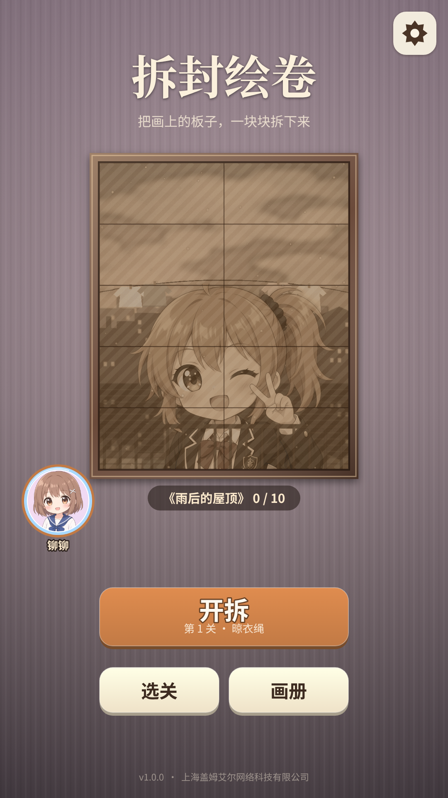
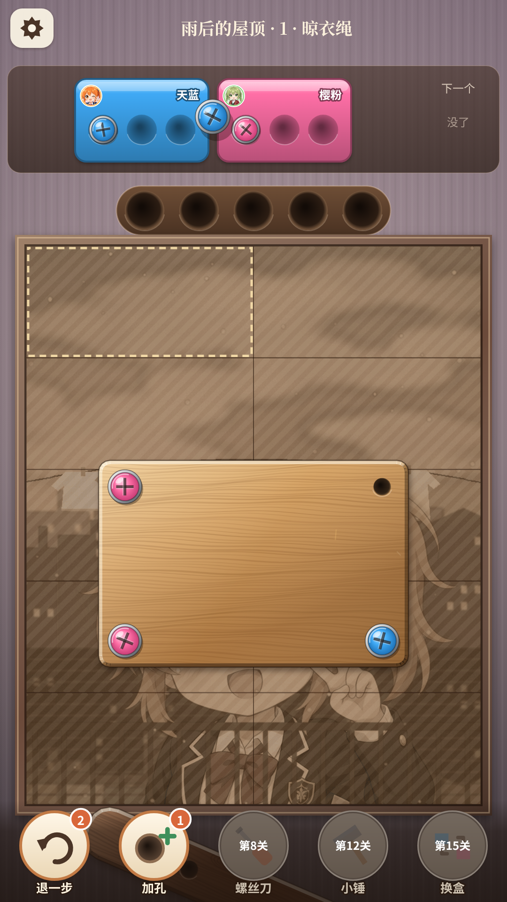
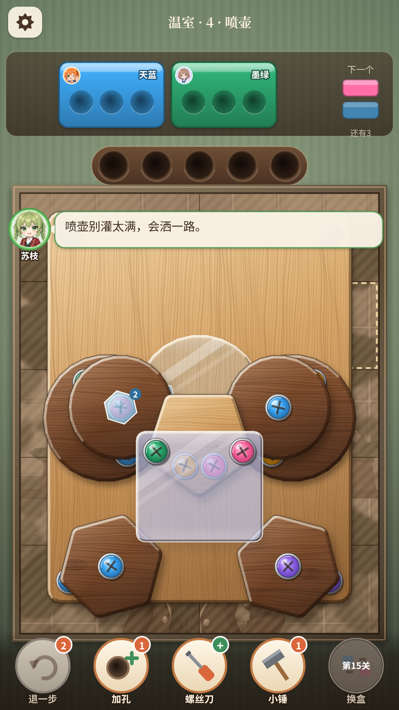

# 拆封绘卷 · AnimeScrew

> 竖屏二次元拧螺丝解谜小游戏｜HTML5 Canvas + Matter.js｜30 关 / 3 幅插画｜网页版 + Windows 桌面版

画框里的插画被一层层木板、铜板、亚克力板钉住，点螺丝把板子拆下来，最底下露出这一关的插画碎片；一幅画 10 块，拼齐收进画册。在"拧螺丝分类"品类玩法上加入 7 种障碍和 5 种道具，30 关由**蓝图 + 难度曲线自动生成**，并用机器人通关率逐关校准。

<p>




</p>

## 玩法

- 点露在最上面的螺丝，它飞进同色收纳盒（同时 2 个盒子，每个 3 格）；没有同色盒子就进临时孔（5 个）。盒子装满换下一个，临时孔里的同色螺丝会自动补进新盒。
- 每颗螺丝是一个物理约束：板上只剩 1 颗时绕它晃，0 颗时掉出画面。
- 临时孔满且无处可放即失败。
- 障碍按章节逐个登场：玻璃、锁链、冰冻、钥匙锁、炸弹（倒计时步数）、隐色、绳吊、双层螺丝。
- 道具：退一步、加孔、螺丝刀、小锤、换盒，分别在第 1 / 1 / 8 / 12 / 15 关解锁。

## 数值设计要点

- **难度曲线逐关配置**（`src/config/DifficultyConfig.js`）：每关定义颜色数（2→6）、参考解最多占用临时孔数、"先放临时孔"倾向，以及**机器人目标通关率**（第 1 关 100% → 终章难关 50%），生成器按目标通关率挑选颜色方案。
- **节奏规则**：相邻两关机器人通关率落差控制在约 12 个百分点内；新机制登场那关单独出现并回落难度；每章一个"第一次真难"的小峰（2-5 / 3-5 / 3-9 提供看广告开第 3 个盒位），峰后接放松关。
- **校验结果**：`npm run verify` 在 Node 中无头运行物理，30 关参考解全部可解、板子都会正常掉落；机器人通关率从 1-1 的 100% 降到 3-9 全机制混合关的 29%，终关 3-10 回到 79% 作为收尾（详见 `docs/verify_report.txt`）。
- **道具经济**：每关使用上限 退一步 3 / 加孔 2 / 螺丝刀 2 / 小锤 1 / 换盒 1，新手初始库存 2 / 1 / 0 / 1 / 1；用完可看激励视频再拿一次。
- **复活与广告点位**：失败可看广告复活（每关最多 2 次，清出 2 个临时孔）；炸弹失败复活时所有引信 +5 步；难关开局可看广告开第 3 个盒位。未配置抖音广告位时为 5 秒占位倒计时。
- **留存**：每关揭开一块插画碎片，拼齐整幅收进画册，可放大查看、分享 / 保存。

## 技术栈

HTML5 Canvas 2D · 原生 JavaScript (ES Modules) · Matter.js 0.19 · esbuild · Electron · Playwright · WebAudio（实时合成 ASMR 音效）· VOICEVOX（角色语音）· Python（程序化生成插画背景与 BGM）

## 如何运行

```bash
npm install
npm start              # 构建并在 http://localhost:8766 启动
npm run build          # 构建到 dist/，可直接双击 dist/index.html
npm run levels         # 按蓝图与难度曲线重新生成关卡数据
npm run verify         # 无头物理校验 30 关可解性
npm test               # 浏览器冒烟测试
npm run test:play      # 浏览器内按参考解打通 30 关
npm run desktop        # Electron 桌面版
npm run pack:win       # 打包 Windows x64
```

目录结构、声音规范与存档说明见 [docs/README.md](docs/README.md)；早期策划案见 [docs/design/策划案-v0.1.md](docs/design/策划案-v0.1.md)（立项阶段文档，引擎选型、排期等与最终实现有出入，以代码为准）。

## 关于开发方式

本项目使用 AI 辅助开发（代码实现与部分素材生成）；玩法设计、障碍与道具规则、关卡难度曲线和数值调优由作者完成。

## 署名

角色语音：VOICEVOX:猫使ビィ / 春日部つむぎ / 東北きりたん / 冥鳴ひまり；角色立绘沿用《美少女合成》素材；Matter.js (MIT)。
