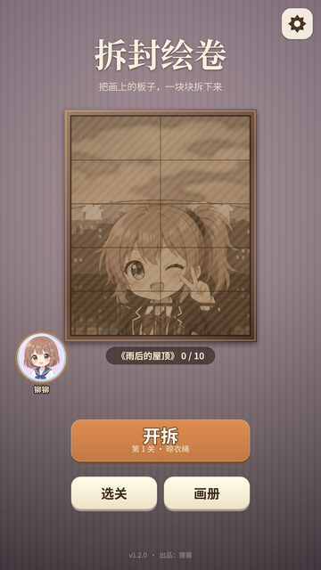
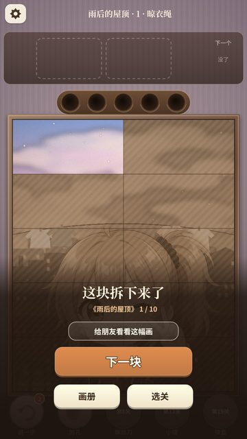
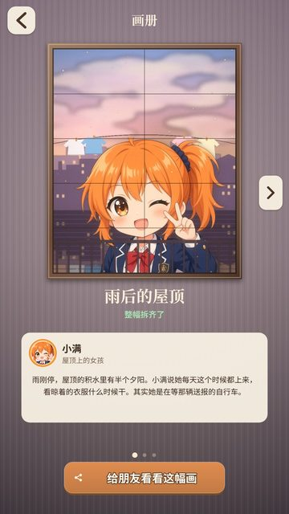

# 拆封绘卷

画框里的插画被木板、铜板、亚克力板一层层钉住了。把螺丝一颗颗拧下来，板子掉光，底下的画就露出来了。

出品：狸猫

## 下载 / 解压 / 双击

到右边的 [**Releases**](https://github.com/limoaCatherine/anime-screw/releases/latest) 下载，不用安装任何东西：

- **Windows 版**：下载 `chaifeng-huijuan-windows.zip`，解压后双击 `拆封绘卷\拆封绘卷.exe`。
  - 第一次打开如果弹出「Windows 已保护你的电脑」，点「更多信息 → 仍要运行」。
  - 存档在 `%APPDATA%\AnimeScrew\save.json`，换新版本也不会丢。
- **网页版**（任何系统都能玩）：下载 `chaifeng-huijuan-web.zip`，解压后双击里面的 `index.html`，用浏览器打开就能玩，不用联网。
  - 进度存在浏览器里。换浏览器或清理浏览数据后，进度会丢。

## 怎么玩

- 点露在最上面的螺丝，它会飞进同色的盒子。
  - 场上同时有两个盒子，各装 3 颗。
  - 装满就合上，换下一个。
- 没有同色的盒子时，螺丝先放进下面的 5 个临时孔。等同色盒子来了，它会自己飞过去。
- 板子上的螺丝拧得只剩一颗时，板子会绕着它晃；一颗都不剩，板子就掉下去。
- 临时孔塞满、再也放不下，这一关就失败了。每关有一次免费「再试一次」。
- 每过一关，揭开插画的一块。10 块拼成一整幅，收进画册。

## 关卡

一共 30 关，分 3 章，每章对应一幅画：雨后的屋顶、温室、夜班电车。

新的障碍会一个个登场：

- **玻璃**：看得见底下的螺丝，但一样压着它们。
- **锁链**：被链子拴住的螺丝拧不动，先拧掉挂锁那颗。
- **冰冻**：在旁边拧螺丝，冰会一层层裂开。
- **钥匙锁**：同色的钥匙钉收进盒子，锁才会开。
- **炸弹**：数字是剩下的步数，归零前必须拧掉。
- **问号螺丝**：拧下来才知道是什么颜色。
- **吊着的板**：拧掉挂钉，整块板连同上面的螺丝一起收走。
- **双层螺丝**：要拧两次。

卡住的时候可以用道具：退一步、加孔、螺丝刀、小锤、换盒。道具用完后，每种每天可以免费领一个。

## 配音与署名

- 角色语音：VOICEVOX:四国めたん（铆铆）、VOICEVOX:春日部つむぎ（小满）、VOICEVOX:東北きりたん（苏枝）、VOICEVOX:冥鳴ひまり（阿蘅）。
  - 各角色的使用条款放在下载包的 `licenses` 文件夹里。
- 物理引擎：Matter.js（MIT）；桌面版外壳：Electron（MIT）。
- 背景音乐、插画背景和音效都是原创。

出品：狸猫

---

想自己改代码或重新打包，请看 [docs/README.md](docs/README.md)。
