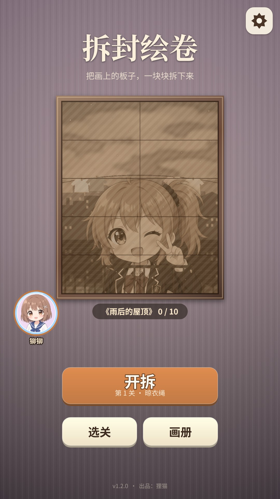
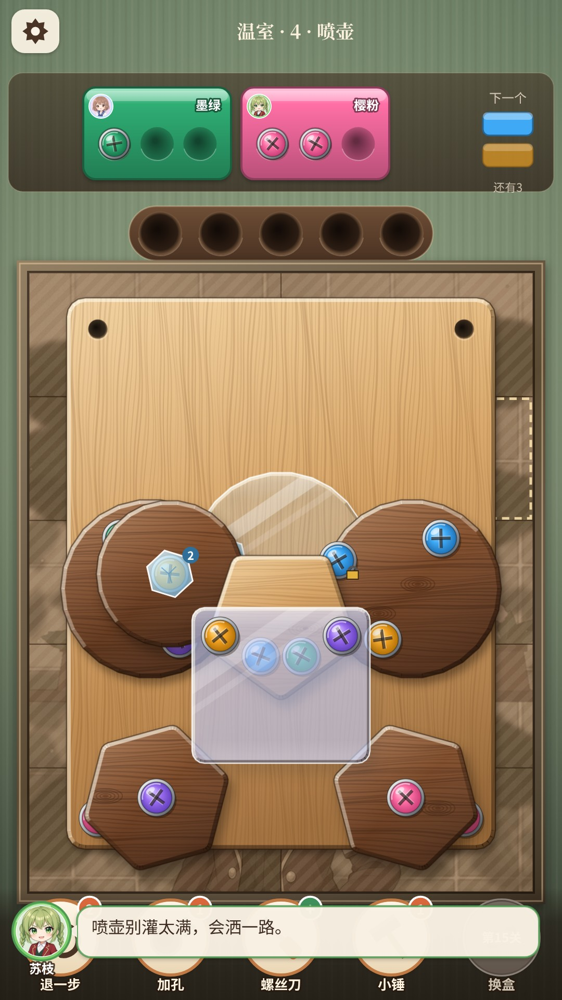
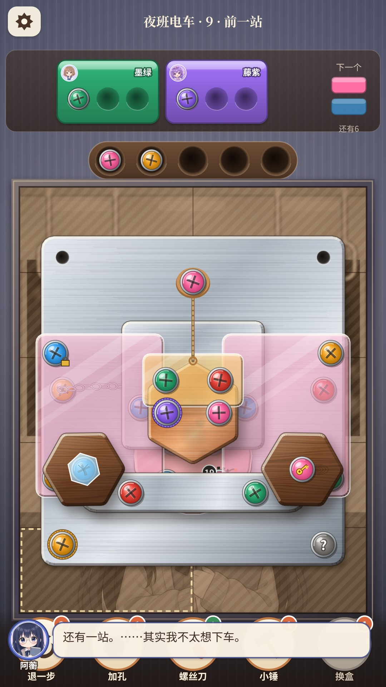

# 拆封绘卷 · AnimeScrew

> 竖屏二次元拧螺丝解谜小游戏｜HTML5 Canvas + Matter.js｜30 关 / 3 幅原创插画
> 网页版 + Windows 桌面版 + 抖音小游戏 + 微信小游戏｜v1.2.0｜出品：狸猫

画框里的插画被一层层木板、铜板、亚克力板钉住。点螺丝把板子拆下来，最底下就露出这一关的插画碎片。一幅画 10 块，拼齐后收进画册。

<p>




</p>

## 快速开始

```bash
npm install
npm run build          # 网页版 → dist/index.html (双击即可玩)
npm run desktop        # Electron 桌面版
npm run pack:win       # Windows exe → release/
npm run build:douyin   # 抖音小游戏 → douyin/dist/
npm run build:wechat   # 微信小游戏 → wechat/dist/
```

测试命令：

- `npm test`：冒烟测试；
- `npm run verify`：30 关可解性；
- `npm run fuzz`：道具模糊测试；
- `npm run test:play`：全关通关；
- `npm run test:douyin` / `npm run test:wechat`：小游戏模拟环境，用触摸打完第 1 关；
- `npm run test:looptrack`：BGM 无缝循环仿真。

## 目录

| 路径 | 内容 |
|---|---|
| `src/` | 游戏代码（所有平台共用） |
| `src/platform/` | 平台层：`web`（网页/桌面）、`douyin`、`wechat`、`mini`（两个小游戏共用） |
| `assets/` | 插画、角色、语音（VOICEVOX）、BGM、预渲染音效 |
| `desktop/` | Electron 外壳 |
| `douyin/`、`wechat/` | 小游戏工程配置（`*.config.json`：AppID 和激励视频广告位 ID），以及构建、测试报告 |
| `tools/` | 关卡生成与校验、构建、打包、测试脚本 |
| `docs/` | 详细说明、抖音和微信上架说明、商店素材、第三方许可 |

详细的设计和实现说明见 [docs/README.md](docs/README.md)。上架流程见：

- [docs/抖音上架说明.md](docs/抖音上架说明.md)
- [docs/微信上架说明.md](docs/微信上架说明.md)

## 广告

激励视频广告位 ID 为空时（网页版、桌面版、小游戏首发版）：

- 不显示任何「看广告」按钮；
- 每关有 1 次免费「再试一次」；
- 道具用完后，每种每天可免费领 1 个。

填上广告位 ID 后，激励视频会自动启用。

## 署名与许可

- 出品：狸猫。
- 语音：VOICEVOX:四国めたん / 春日部つむぎ / 東北きりたん / 冥鳴ひまり（按各角色规约署名，全文见 `docs/licenses/`）。
- 物理引擎：Matter.js（MIT）。
- 本仓库代码与美术资源未开源授权（UNLICENSED）。
